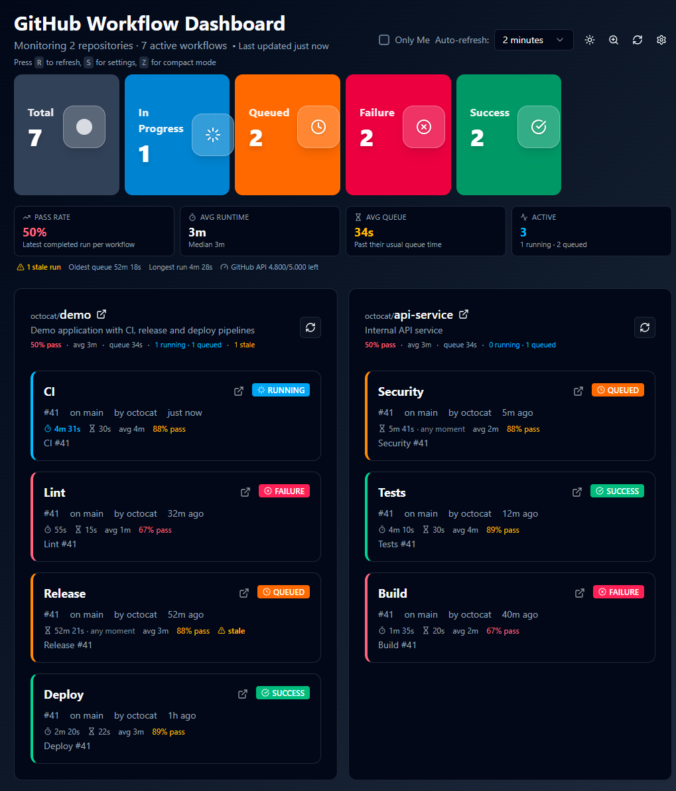

# GitHub Workflow Monitor

A self-hosted dashboard for GitHub Actions: current status, **runtime**, **queue
time**, pass rate and stale-run detection across every repository you monitor.

It is a client-only Next.js app. Your GitHub token never touches a backend — the
browser talks directly to `api.github.com` and stores the token encrypted.

[](https://github.com/arumes31/github-workflow-dashboard/actions/workflows/ci.yml)
[](https://github.com/arumes31/github-workflow-dashboard/actions/workflows/codeql.yml)
[](https://github.com/arumes31/github-workflow-dashboard/actions/workflows/docker-publish.yml)

## Features

- **Live workflow status** for every selected repository (running, queued,
  waiting, success, failure, cancelled, skipped, timed out).
- **Runtime and queue metrics** per workflow and across the fleet: average and
  median runtime, average queue wait, estimated remaining queue time, oldest
  queued run and longest running run.
- **Reliability signals**: pass rate over the recent window, consecutive
  failures, last success, and stale-run warnings (running > 90 min, queued >
  45 min).
- **Per-job breakdown** on demand: job status, duration, runner, and the failed
  step for each job in a run.
- **Runner utilization**: active jobs grouped by runner, with running/queued
  counts and average runtime.
- **Browser alerts** for default-branch failures, long queues and long runtimes;
  delivered while the dashboard is open, with no server involved.
- **Fleet metrics strip** with pass rate, average runtime, average queue, active
  runs, stale count and the GitHub API quota left.
- **Filters** by status/conclusion, "Only me", repository search, compact mode,
  dark mode and configurable auto-refresh (10 seconds to 1 hour).
- **Token handling**: AES-256-GCM encryption, random per-browser key in
  IndexedDB, token masked after saving, scope/quota display and warnings for
  over-privileged tokens.
- **Security headers**: CSP, HSTS, `X-Frame-Options: DENY`, COOP/CORP,
  `Permissions-Policy`, `nosniff`, no `X-Powered-By`.
- **Hardened container**: multi-stage build, non-root, read-only root filesystem
  and dropped capabilities in Compose.
- **No external assets**: all JavaScript, CSS and fonts are bundled and served
  from the app origin; no CDN, Google Fonts or third-party script tags.



## Quick start

### Docker (recommended)

```bash
docker compose pull
docker compose up -d
```

Open <http://localhost:3000>. Compose binds to loopback only; use a
TLS-terminating reverse proxy if you need remote access. To build locally
instead:

```bash
docker compose up --build
```

Or run the image directly:

```bash
docker run --rm -p 3000:3000 \
  --read-only --tmpfs /tmp --tmpfs /app/.next/cache \
  --security-opt no-new-privileges:true --cap-drop ALL \
  ghcr.io/arumes31/github-workflow-dashboard:latest
```

Images are published to GHCR for `linux/amd64` and `linux/arm64` on every push
to `main` (tag `latest` and `edge`/branch), on `v*.*.*` tags (semver tags) and
with an immutable `sha-*` tag. Each image includes a build attestation and SBOM.

### Node.js

Requires Node.js 22+ (CI and the container use Node 24).

```bash
npm ci
npm run dev      # http://localhost:3000
```

Production build:

```bash
npm run build
npm start
```

## Configuration

Open **Settings** and add a GitHub token.

Recommended: a **fine-grained** token with read-only access to the repositories
you monitor:

- **Actions** — Read
- **Contents** — Read
- **Metadata** — Read (automatic)

For organization repositories you may also need `read:org` and organization
approval for the token. Classic tokens work too (`repo`, or `public_repo` for
public repositories only). The dashboard never needs write access.

> The dashboard is hosted on your own origin. Use a dedicated, expiring token and
> remove it from Settings before using a shared computer.

### Metrics definitions

GitHub exposes three timestamps per run: `created_at` (queued),
`run_started_at` (picked up by a runner) and `updated_at` (last state change).

- **Queue time** = `run_started_at - created_at`. For a run that is still queued,
  it is `now - created_at`.
- **Runtime** = `updated_at - run_started_at` for completed runs, or
  `now - run_started_at` for a running run.
- **Estimated remaining queue** = the workflow's median queue time minus the
  current wait, floored at zero. It is a heuristic based on the last 50 runs.
- **Pass rate** = successful / (successful + failed + timed out) for the latest
  completed run of each workflow in the recent window.

Statistics are computed from the most recent 50 runs per repository, fetched in a
single GitHub API call per repository and refreshed on your chosen interval with
±10% jitter.

## Development

```bash
npm run lint
npm run typecheck
npm test -- --ci --coverage
npm run build
```

Tests use Jest and Testing Library and run on Linux in Docker:

```bash
docker run --rm -v "$PWD:/app" -v gwm_node_modules:/app/node_modules \
  -w /app node:24-alpine sh -c "npm ci && npm test -- --ci"
```

## CI/CD and security automation

| Workflow | Purpose |
| --- | --- |
| `ci.yml` | Lint, typecheck, tests, coverage artifact, production build, production dependency audit |
| `codeql.yml` | CodeQL security-and-quality analysis for JavaScript/TypeScript |
| `dependency-review.yml` | Blocks PRs that introduce high/critical vulnerable dependencies |
| `docker-publish.yml` | Multi-arch GHCR image, SBOM, provenance attestation, Trivy image scan |
| `gitleaks.yml` | Secret scanning on every push and PR |
| `scorecard.yml` | OpenSSF Scorecard, published to code scanning |
| `release.yml` | GitHub release with generated notes on `v*.*.*` tags |

Dependabot keeps npm, GitHub Actions and the Docker base image current.

See [SECURITY.md](SECURITY.md) for the disclosure process and
[`docs/SECURITY-AUDIT.md`](docs/SECURITY-AUDIT.md) for the audit, findings and
residual risks.

## Limitations

- GitHub does not report an exact queue estimate. The estimate is a median of
  the repository's recent runs and will be wrong for a cold cache or a sudden
  runner shortage.
- `updated_at` can move after completion (for example, on re-run); runtime is the
  best approximation available from the Runs API.
- Very large organizations are capped at 2,000 repositories per owner and 50
  recent runs per repository to stay within rate limits.
- This is a monitoring UI, not an alerting service. Browser alerts fire only
  while the dashboard is open; there is no server-side pager or email.
- Job details and runner utilization use the Actions jobs endpoint, one request
  per expanded run or active run (up to 10) and therefore consume extra API
  quota.

## License

MIT — see [LICENSE](LICENSE).
